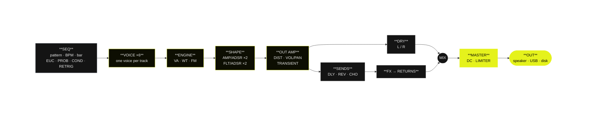

# M-WORM

**Elektron-style groovebox on MVAVE FM-1**
---

| Feature | Capabilities |
| --- | --- |
| Sound | 6 mono voices, per - track -> VA, FM, two oscillators, WT one oscillator, filters, envelopes, LFOs, parameter modulation |
| Sequencer | 128 steps, 8 pages, per-step p-locks, retrigs, conditions, microtiming, Euclidean rhythms |
| Presets | 32 slots, including a preset per step |
| Effects | delay / reverb / chorus + master limiter |
| MIDI | 4 MIDI tracks, USB device and USB host, CC lanes, MIDI panic (All Notes Off) |
| Memory | 8 banks × 16 patterns = 128 patterns |
| Connectivity | USB audio, USB MIDI, USB disk for bank files |


# M-WORM FM-1 — How the sound works

> **In one sentence:** the pattern says *what* to play → the sequencer decides *when* → the voice takes the note → the engine makes the sound → AMP/ADSR sets the level → the filter shapes the tone → TRANSIENT adds the attack → the dry signal and SENDS go to the mixer/FX → master → limiter → output.

---

## Signal flow

> GitHub draws its own pan/zoom controls over Mermaid; the `diagramPadding` setting below keeps them away from the content.



If Mermaid does not render, here is the same chain as text:

```text
PATTERN → SEQUENCER → VOICE → ENGINE
        → AMP/ADSR ×2 → FILTER ×2 + ADSR ×2
        → AMP DIST → VOL/PAN → TRANSIENT
        → { DRY → L/R   ‖   SENDS → FX → RETURNS }
        → MIX → MASTER → DC BLOCK → LIMITER → OUTPUT
```

---

## 1. Sequencer

| Block | What it does |
|---|---|
| **PATTERN** | Stores steps: note, velocity, length, p-lock. BPM lives in the pattern (`B7 + u16 BPM*10`). |
| **CLOCK / BAR** | Tracks BPM, the bar, and each track's own clock: length, direction, speed, swing. |
| **TRIGGER** | Decides whether to play a step: EUCLID, `PROB`, conditions `1ST / FILL / 4BAR / NEV`, `RETRIG`. |
| **Pattern change** | Queued and applied exactly at the bar boundary so the rhythm is not cut. |
| **P-lock / AUT** | Step preset first, then its p-locks; on top — automation, 4 LFOs and free ENV4. |

---

## 2. Voice and engine

**6 audio tracks = 6 monophonic voices.** Each track has its own voice, patch and clock. There is no voice pool: a retrigger restarts the same voice.

| Engine | Range | Sound source |
|---|---|---|
| **VA** | `WAVE 0..5` | `SIN · TRI · SAW · SQR · PLS · NOI` |
| **WAVETABLE** | `WAVE 6..10` | 5 main tables, 64 frames each, built into firmware |
|  | `WAVE 11..17` | 7 user slots from `WTABLE.WPT` |
|  | `WAVE 18..57` | 40 library tables, built into firmware |
| **FM** | 8 algorithms | Operators `C / A / B1 / B2`, `X / Y` crossfade, equal-power `MIX` |

> Do not confuse: global `ALGO` selects **VA / FM / WT**, while `0..7` is the FM algorithm number inside the engine.

---

## 3. AMP, ADSR and filters

| Envelope | Purpose |
|---|---|
| `E0` | AMP of the `OSC1 + SUB` channel |
| `E3` | AMP of the `OSC2` channel |
| `E1` | Filter `F1` |
| `E2` | Filter `F2` |
| `E4` | Free ADSR for `DEST` routing — not a separate block in the chain |

Order inside a voice:

```text
generator → drive → AMP/ADSR → its own filter
```

- **VA / WAVETABLE:** `F1` works on `X / OSC1`, `F2` works on `Y / OSC2`; the two channels are parallel.
- **FM:** the `OSC2` channel is off; `F2` runs **after `F1`, in series**, on `X`.
- FM also has its own envelopes for operators `A` and `B` inside the engine.

Filter types: `OFF / LP / HP / BP` (TPT SVF).

---

## 4. TRANSIENT, SENDS and FX

After the filter, the signal goes through:

```text
AMP DIST → AMP VOL / PAN → AMP TRANSIENT
```

- **AMP TRANSIENT** — attack accent: the note hits harder at the start and quickly decays. It is a per-track setting and can be p-locked and modulated.
- **SENDS** — send levels of a copy of the sound to the shared effects: `SEND DELAY`, `SEND REVERB`, `SEND CHORUS`.
- **The dry signal and SENDS run in parallel**, not one after the other.
- **RETURNS** come back from the FX block and join the dry signal just before master.

Result:

```text
                 ┌─ DRY → L/R ────────────┐
TRANSIENT ───────┤                        ├→ MIX → MASTER → DC → LIMITER → OUTPUT
                 └─ SENDS → FX → RETURNS ─┘
```

`DC BLOCK` before the limiter removes the DC offset.

---

## 5. Under the hood

- Rendering is split into 64-sample chunks; the boundaries line up with sequencer events.
- **CPU1** computes part of the active voices and the reverb.
- **CPU0** computes the remaining voices, delay, chorus, buses, master and limiter.
- If CPU1 does not respond, calculations roll back to CPU0 and it falls back to a single core.

---

## 6. Where the sound goes

| Output | What it is |
|---|---|
| **FM-1 speaker** | 24-bit stream through ALNK0 / I2S to the external codec |
| **USB audio** | mixer with computer recording/playback |
| **MSC virtual disk** | `WTABLE.WPT`, `.WPB` banks, `.pat` patterns, projects |

---

> Old code comments and `docs/MANUAL.md` still mention 4 tracks/voices and an "unused CPU1". That is outdated: the current scheme has 6 voices and CPU1 is used.
