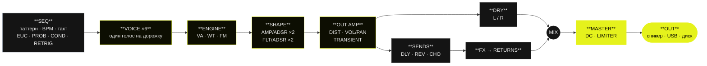

# M-WORM

**Elektron-style groovebox on MVAVE FM-1**
---

| Feature | Capabilities |
| --- | --- |
| Sound | 6 mono voices, per - track -> VA, FM, two oscillators, WT one oscillator, filters, envelopes, LFOs, parameter modulation |
| Sequencer | 128 steps, 8 pages, per-step p-locks, retrigs, conditions, microtiming, Euclidean rhythms |
| Presets | 32 slots, including a preset per step |
| Effects | delay / reverb / chorus + master limiter |
| MIDI | 4 MIDI tracks, USB device and USB host, CC lanes, MIDI panic (All Notes Off) |
| Memory | 8 banks × 16 patterns = 128 patterns |
| Connectivity | USB audio, USB MIDI, USB disk for bank files |


# M-WORM FM-1 — как устроен звук

> **Одной фразой:** паттерн говорит, *что* играть → секвенсор решает, *когда* → голос берёт ноту → движок делает звук → AMP/ADSR задаёт громкость → фильтр красит тембр → TRANSIENT добавляет атаку → сухой сигнал и SENDS уходят в микшер/эффекты → мастер → лимитер → выход.

---

## Общая схема



Если Mermaid не рисуется, та же цепочка текстом:

```text
ПАТТЕРН → СЕКВЕНСОР → ГОЛОС → ДВИЖОК
        → AMP/ADSR ×2 → ФИЛЬТР ×2 + ADSR ×2
        → AMP DIST → VOL/PAN → TRANSIENT
        → { СУХОЙ → L/R   ‖   SENDS → FX → RETURNS }
        → МИКС → МАСТЕР → DC BLOCK → ЛИМИТЕР → ВЫХОД
```

---

## 1. Секвенсор

| Блок | Что делает |
|---|---|
| **PATTERN** | Хранит шаги: ноту, громкость, длительность, p-lock. BPM лежит прямо в паттерне (`B7 + u16 BPM*10`). |
| **CLOCK / BAR** | Считает BPM, такт и собственные часы каждой дорожки: длина, направление, скорость, свинг. |
| **TRIGGER** | Решает, играть шаг или нет: EUCLID, `PROB`, условия `1ST / FILL / 4BAR / NEV`, повторы `RETRIG`. |
| **Смена паттерна** | Ставит запрос и применяет его строго на границе такта, чтобы не порвать ритм. |
| **P-lock / AUT** | Сначала берётся пресет шага, потом его p-lock; поверх — автоматизация, 4 LFO и свободный ENV4. |

---

## 2. Голос и движок

**6 аудиодорожек = 6 моноголосов.** У каждой дорожки — свой один голос, свой патч и свои часы. Полифонии как пула нет: новый ретриггер перезапускает тот же голос.

| Движок | Диапазон | Источник звука |
|---|---|---|
| **VA** | `WAVE 0..5` | `SIN · TRI · SAW · SQR · PLS · NOI` |
| **WAVETABLE** | `WAVE 6..10` | 5 основных таблиц по 64 кадра, зашиты в прошивку |
|  | `WAVE 11..17` | 7 пользовательских слотов из `WTABLE.WPT` |
|  | `WAVE 18..57` | 40 таблиц библиотеки, зашиты в прошивку |
| **FM** | 8 алгоритмов | Операторы `C / A / B1 / B2`, кроссфейд `X / Y`, равномощный `MIX` |

> Не путать: глобальный `ALGO` выбирает **VA / FM / WT**, а `0..7` у FM — это уже номер fm-алгоритма внутри движка.

---

## 3. AMP, ADSR и фильтры

| Огибающая | Назначение |
|---|---|
| `E0` | AMP канала `OSC1 + SUB` |
| `E3` | AMP канала `OSC2` |
| `E1` | Фильтр `F1` |
| `E2` | Фильтр `F2` |
| `E4` | Свободная ADSR для маршрутизации через `DEST` — отдельным блоком в цепи не стоит |

Порядок внутри голоса:

```text
генератор → drive → AMP/ADSR → свой фильтр
```

- **VA / WAVETABLE:** `F1` работает на `X / OSC1`, `F2` — на `Y / OSC2`, два канала параллельны.
- **FM:** канал `OSC2` выключен, `F2` идёт **после `F1` последовательно** по `X`.
- У FM внутри движка дополнительно есть свои огибающие у операторов `A` и `B`.

Типы фильтра: `OFF / LP / HP / BP` (TPT SVF).

---

## 4. TRANSIENT, SENDS и FX

После фильтра сигнал проходит:

```text
AMP DIST → AMP VOL / PAN → AMP TRANSIENT
```

- **AMP TRANSIENT** — акцент атаки: нота «бьёт» резче в начале и быстро спадает. Настройка каждой дорожки, может быть p-lock и модулироваться.
- **SENDS** — уровни отправки копии звука в общие эффекты: `SEND DELAY`, `SEND REVERB`, `SEND CHORUS`.
- **Сухой сигнал и SENDS идут параллельно**, не друг за другом.
- **RETURNS** приходят из блока FX и соединяются с сухим сигналом уже перед мастером.

Итог:

```text
                 ┌─ СУХОЙ → L/R ──────────┐
TRANSIENT ───────┤                        ├→ МИКС → МАСТЕР → DC → ЛИМИТЕР → ВЫХОД
                 └─ SENDS → FX → RETURNS ─┘
```

`DC BLOCK` перед лимитером убирает постоянную составляющую.

---

## 5. Что происходит «под капотом»

- Рендер режется на куски по 64 сэмпла; границы совпадают с событиями секвенсора.
- **CPU1** считает часть активных голосов и реверб.
- **CPU0** считает остальные голоса, дилей, хорус, шины, мастер и лимитер.
- Если CPU1 не отвечает — есть откат вычислений на CPU0 и полный переход на одно ядро.

---

## 6. Куда уходит звук

| Выход | Что это |
|---|---|
| **Динамик FM-1** | 24-битный поток через ALNK0 / I2S во внешний кодек |
| **USB-аудио** | микшер с компьютерной записью/воспроизведением |
| **Виртуальный диск MSC** | `WTABLE.WPT`, банки `.WPB`, паттерны `.pat`, проекты |

---

> Старые комментарии в коде и `docs/MANUAL.md` местами говорят про 4 дорожки/голоса и «неиспользуемый CPU1». Это устарело: актуальная схема — 6 голосов и CPU1 используется.
